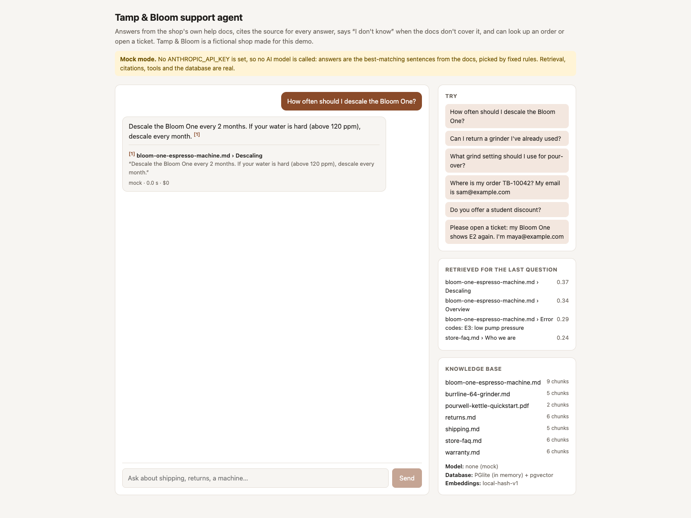
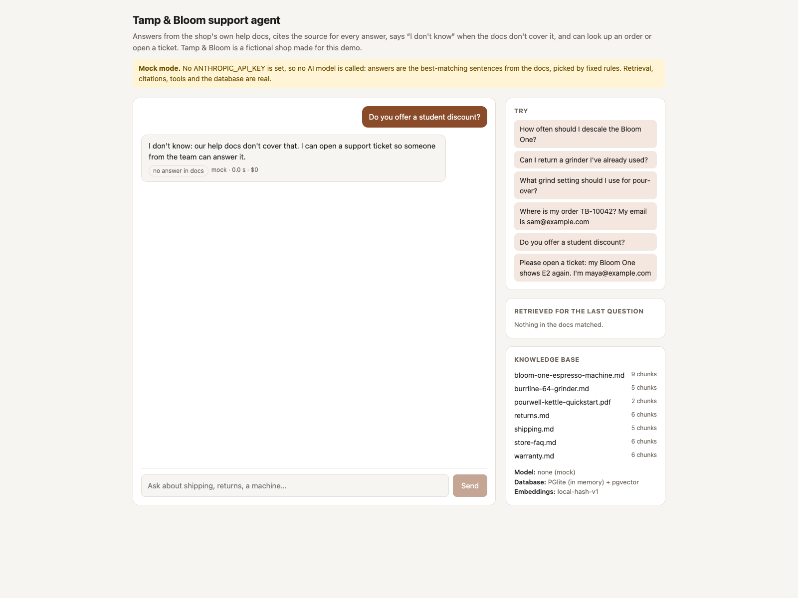
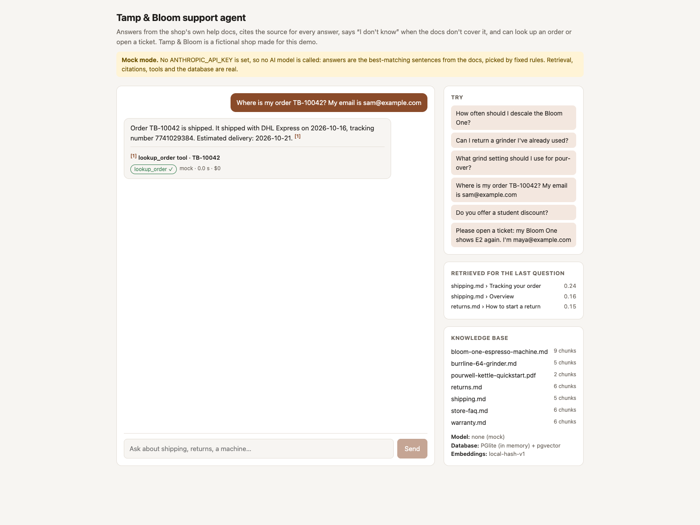
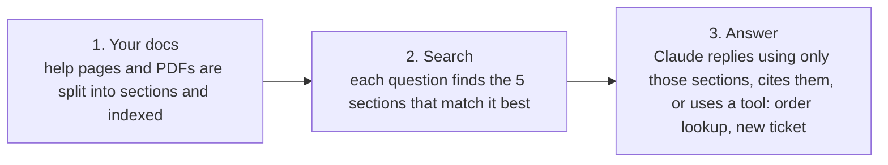

# AI support agent that answers from your own docs

A chat assistant for a small business's website. It answers customer questions using only the business's own help pages and manuals, shows exactly where each answer came from, says "I don't know" instead of making something up, and can check an order or open a support ticket.

This is a demo built for **Tamp & Bloom, a made-up coffee-equipment shop**. It isn't a client project. The shop, its help pages, orders and customers are all invented.



## What it does
- **Answers from your docs, and only your docs.** It reads your help pages (Markdown) and PDF manuals. Ask "How often should I descale the Bloom One?" and it answers from the care guide.
- **Shows its source for every answer.** Each answer has a numbered reference like `[1]` pointing to the exact page and section it used, with the quoted passage, so you and your customers can check it.
- **Says "I don't know" when your docs don't cover it.** Ask about a student discount the shop doesn't have, and it says so and offers to open a ticket, instead of inventing a policy.
- **Takes actions.** It can look up an order (it asks for the order number *and* the email on the order before showing anything) and open a support ticket for your team.
- **Shows what each answer cost.** Every reply shows the model used, how long it took and its cost in dollars.

| Says "I don't know" | Looks up an order |
|---|---|
|  |  |

## How it works

If none of the sections answer the question, step 3 replies "I don't know" and offers a ticket. A safety check in the code also blocks any factual answer that doesn't cite a source.

## How well it answers
A test set of 15 questions with known answers is run with `npm run eval`: 10 the docs answer, 2 they don't (it must say "I don't know"), and 3 that need a tool (including one where the wrong email must *not* reveal the order).

| | Score |
|---|---|
| Search finds the section with the answer (top 5) | **10 / 10** |
| Full answer correct, in free mock mode | **13 / 15** |

Mock mode is a free stand-in for the AI (see below): it quotes the best-matching sentence from the top search result. The 2 questions it misses have the right section in the search results at positions 2 and 5. Claude reads all 5 results, so these are the ones to watch when the eval runs with a real API key. That run hasn't been done yet.

## Try it
Needs Node.js 22.9 or later.
```bash
npm install
npm run dev
```
Open http://localhost:3000 and click one of the sample questions. Nothing else to set up: it starts its own small database, loads the demo docs, and runs in **mock mode**, which is clearly labelled on the page. Mock mode calls no AI model and costs nothing. To use Claude, put an `ANTHROPIC_API_KEY` in a `.env` file (see `.env.example`) and restart.

## Putting it on your docs
What it would take for a real business:
1. **Your content.** Your help pages, FAQs and manuals as Markdown or PDF files, replacing the demo files in `docs/`. Pages from a website or help desk can be exported to Markdown.
2. **Your accounts.** An Anthropic API key and a Supabase project (or any Postgres database), both in your name, so your data and costs stay with you.
3. **Your systems.** The two actions here work on demo tables. For your shop they'd call your real order system and help desk (Shopify, Zendesk, your own API…), with the same checks.
4. **Your questions.** 15–20 real customer questions with the right answers become your test set, run before and after every change.
5. **Your site.** Add the chat to your website or app, and decide what it should hand to a person.

## For developers

**Stack:** Next.js 16 · Postgres + pgvector (Supabase, or PGlite in memory locally) · Claude API (`claude-opus-5-5`) with tool use and native citations · TypeScript · zod · Vitest · Playwright.

### Modes
| Mode | When | Answers come from |
|---|---|---|
| **Mock** (labelled in the UI) | No `ANTHROPIC_API_KEY`, or `MOCK_LLM=1` | The best-matching sentence of the top chunk, picked by fixed rules. No model call. Retrieval, citations, tools and the database are the real code. |
| **Live** | `ANTHROPIC_API_KEY` set | Claude (`claude-opus-5-5` by default, `ANTHROPIC_MODEL` to change) at low effort, with server-side refusal fallback on. Estimated $0.01–0.03 per answer; the UI and eval show the measured cost. |

### Supabase
```bash
# .env: DATABASE_URL=postgresql://... (Supabase → Project settings → Database)
npm run db:setup   # applies supabase/migrations + seed.sql, then ingests docs/
npm run dev
```
`npm run ingest` re-ingests after `docs/` changes: unchanged files are skipped, changed ones replaced, deleted ones removed.

### Embeddings
The default embedder is a local word-hashing embedder: free, offline and deterministic, but it matches words, not meaning. For real use, set `VOYAGE_API_KEY` and `VOYAGE_MODEL` and re-ingest. Vectors are 1024-dimensional either way. Retrieval returns the top 5 chunks, at most 3 from any one file.

### Guardrails
- Order lookup needs the order number and the email, and gives the same "no match" reply whether the order doesn't exist or the email is wrong, so it can't be used to discover orders.
- A ticket can't be attached to someone else's order, and one email address can open at most 3 tickets an hour.
- Tool inputs are validated with strict zod schemas. Unknown fields, malformed order numbers or bad emails go back to Claude as an error instead of running.
- Grounding guard: a factual reply with no citation and no tool result is replaced by the "I don't know" reply. Questions back to the customer pass.
- The tool loop stops after 5 rounds.
- Tables have row-level security on with no policies, so Supabase's public `anon` key can't read orders or tickets. Only the server talks to the database.

### Tests
```bash
npm test           # 47 tests, no network, no API key
```
Retrieval (right chunk first, nothing for out-of-scope questions, per-file cap, idempotent re-ingest), citations (every cited passage exists in the database), refusals, tool validation, and the live Claude path against a scripted fake client: request shape, tool loop, invalid tool input, citation mapping, grounding guard, round limit and cost.

`npm run screenshots` rebuilds the app and retakes the screenshots in `docs/screenshots/` in mock mode, using your installed Google Chrome.

### Files
| File | What's in it |
|---|---|
| `src/lib/ingest.ts`, `chunk.ts` | Markdown/PDF → chunks (by heading, list items split, long sections split with overlap) → embeddings |
| `src/lib/retrieve.ts` | Similarity search through the `match_chunks` SQL function, per-file cap |
| `src/lib/agent.ts` | System prompt, Claude tool loop, citation mapping, grounding guard, mock mode |
| `src/lib/tools.ts` | Tool schemas and validated handlers |
| `supabase/migrations/` | Tables, HNSW index, `match_chunks`, RLS |
| `evals/questions.json`, `scripts/eval.ts` | The 15-question eval |

### Limits
- Each question is searched on its own, so a vague follow-up ("and for grinders?") can miss.
- Answers aren't streamed yet.
- In mock mode, answers are quoted sentences, not written replies.
- Never run against a live Supabase project or with Voyage embeddings; both paths share the tested code but haven't been exercised.

MIT licence.
